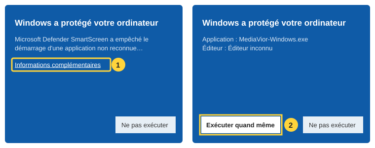
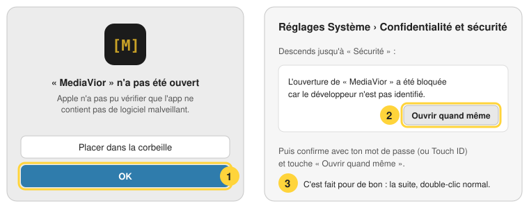

# Installer MediaVior sur ton ordinateur

Télécharge le fichier de ton système, puis double-clique dessus. Tout est inclus (Python, yt-dlp,
ffmpeg) : rien d'autre à installer. Gratuit, sans compte. [English version](INSTALLER.en.md).

| Système | Fichier |
|---|---|
| **Windows** 10 et 11 | [MediaVior-Windows.exe](https://github.com/chr2l/MediaVior/releases/latest/download/MediaVior-Windows.exe) |
| **Mac** à puce Apple (M1 et plus récents) | [MediaVior-Mac.dmg](https://github.com/chr2l/MediaVior/releases/latest/download/MediaVior-Mac.dmg) |
| **Linux** (64 bits) | [MediaVior-Linux.AppImage](https://github.com/chr2l/MediaVior/releases/latest/download/MediaVior-Linux.AppImage) |

Mac à processeur Intel : utilise [le prompt](../README.md#en-un-prompt) ou [Pinokio](../README.md#avec-pinokio).

## Pourquoi un avertissement au premier lancement ?

Windows et le Mac se méfient des applis qui n'ont pas de **signature payante** (environ 100 € par
an). MediaVior est un projet libre et gratuit, sans cette signature. Son code est public : tout le
monde peut vérifier ce qu'il fait. Le fichier est construit automatiquement par GitHub à partir de
ce code.

Il faut donc dire une fois à ton ordinateur que tu lui fais confiance. Ensuite, il ne demande plus.

### Windows

1. Double-clique sur `MediaVior-Windows.exe`. Une fenêtre bleue « Windows a protégé votre
   ordinateur » s'ouvre : clique sur **Informations complémentaires**.
2. Clique sur **Exécuter quand même**.
3. L'installation prend quelques secondes, sans droits administrateur. MediaVior s'ouvre, et une
   icône est ajoutée au bureau et au menu Démarrer.

L'appli s'installe dans le dossier `MediaVior` de ton dossier personnel (`C:\Users\<ton nom>\MediaVior`,
modifiable à l'installation). Tes médias arrivent juste à côté, dans `MediaVior\MediaChest`.

Si ton antivirus bloque le fichier, c'est pour la même raison (appli non signée qui télécharge des
choses). Tu peux l'autoriser dans ton antivirus, ou passer par [le prompt](../README.md#en-un-prompt).

### Mac

1. Ouvre `MediaVior-Mac.dmg` et glisse **MediaVior** sur le dossier **Applications**.
2. Ouvre MediaVior (Launchpad ou dossier Applications). Le Mac dit qu'il n'a pas pu le vérifier :
   clique sur **OK**.
3. Ouvre **Réglages Système** → **Confidentialité et sécurité**. Tout en bas, à côté de
   « L'ouverture de MediaVior a été bloquée », clique sur **Ouvrir quand même**, puis confirme avec
   ton mot de passe ou Touch ID.

Sur les anciennes versions de macOS (avant Sequoia), un **clic droit sur MediaVior → Ouvrir**
suffit.

### Linux

1. Rends le fichier exécutable : clic droit → **Propriétés** → **Permissions** → coche
   « Autoriser l'exécution » (ou `chmod +x MediaVior-Linux.AppImage`).
2. Double-clique dessus. Au premier lancement, MediaVior s'ajoute au menu des applications.

## Et après ?

- **Mises à jour** : yt-dlp (le moteur de téléchargement) se met à jour tout seul chaque jour. Quand
  une nouvelle version de MediaVior sort, un bouton **Mettre à jour** apparaît en haut de l'appli.
  Sur Windows et Linux, un clic suffit. Sur Mac, il télécharge le nouveau `.dmg` à glisser dans
  Applications.
- **Ton téléphone** : bouton **Téléphone** en haut de l'appli, puis scanne le QR code. Voir
  [le mode d'emploi](UTILISATION.md#sur-téléphone).
- **Désinstaller** : Windows → Paramètres → Applications → MediaVior → Désinstaller. Mac →
  glisse MediaVior à la corbeille. Linux → supprime le fichier AppImage. Tes fichiers restent dans
  le dossier `MediaChest`.
